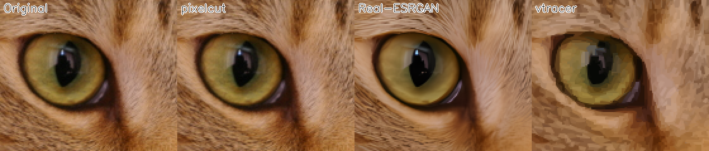
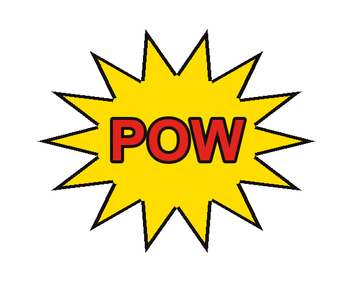
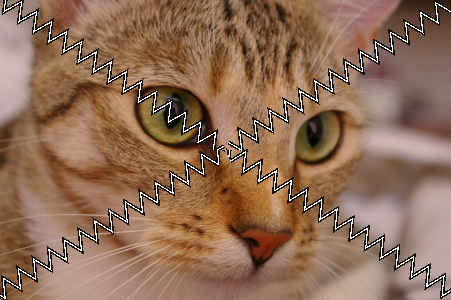
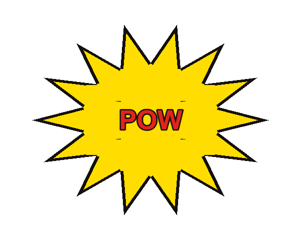

# K&K pixelcut

   

[](https://ko-fi.com/kkwonderland)

**English in short:** a small command-line tool that cuts an image into wedge-shaped parts (free angles, straight or **zig-zag** edges) **without altering a single pixel**, turns a white background into real transparency (exact colour-to-alpha), lifts a word or element out and re-places it, and writes **hit-area polygons** for touch menus. Parts put back together over white give the original back (max deviation <= 1/255, measured with `--verify` and `compare`). It does *not* generate or redraw images and does not upscale without inventing pixels. Works on drawings and photos. Details below (German).

**Ein Bild in Teile zerlegen, ohne ein einziges Pixel zu verändern.**
*Cut a picture into parts without changing a single pixel.*

**Auf einen Blick**

- **Exakt:** Teile über Weiß zusammengesetzt = das Original (höchstens 1/255 Abweichung, bei Fotos 0).
- **Zacken statt Linie:** Keile um eine Mitte, freie Winkel, gerade Kante oder Zickzack.
- **Echte Transparenz:** weißer Hintergrund wird sauber freigestellt, auch weiche Kanten.
- **Trefferflächen:** `parts.json` mit Polygon pro Teil, fertig für Touch-Menüs.
- **Messbar:** `compare` zeigt SSIM und Pixelabweichung, auch für Ergebnisse anderer Werkzeuge.

Gebaut von K&K AI. Entstanden bei einer Handy-App: Ein Comic-Bild sollte zum Menü werden (Blase in vier Teile, Zacken statt Linie, das Wort in der Mitte als Knopf), und es durfte **nicht anders aussehen als das Original**.


---

## Die Idee in drei Sätzen

Die meisten "Bild nachbauen"-Werkzeuge zeichnen neu, tracen oder skalieren hoch. Das Ergebnis sieht dann nur *ähnlich* aus.
pixelcut macht das Gegenteil: Es behält die Original-Pixel und entscheidet nur, **zu welchem Teil jedes Pixel gehört**.
Legt man die Teile wieder zusammen, kommt das Original zurück, Pixel für Pixel, und das Werkzeug misst das selbst nach (`--verify`, `compare`).

**Bedingung:** Das gilt für 8-Bit-Bilder und mit `--gap 0 --edge 0`. Die Standardwerte (`--gap 2.6 --edge 3.2`) schneiden einen sichtbaren Spalt mit Tintenkante, damit man die Teile sieht. Dann weicht das Ergebnis gewollt ab; `--verify` zeigt beide Zahlen. Transparente Bilder werden über Weiß gelegt und 16-Bit-Bilder auf 8 Bit gebracht, beides mit Hinweis.

---

## Download (ohne Python)

Fertige Programme für Windows, Linux (x64 und ARM) und Mac (Apple Silicon und Intel) gibt es unter [Releases](https://github.com/CalyieX/pixelcut/releases/latest). Jedes Programm wurde vor dem Hochladen auf seinem eigenen System mit einem Rundlauftest geprüft.

```bash
# Linux / Mac: einmal ausführbar machen, dann starten
chmod +x pixelcut-linux-x64        # bzw. pixelcut-macos-arm64
./pixelcut-linux-x64 --help

# Windows (PowerShell)
.\pixelcut-windows-x64.exe --help
```

Mac: Beim ersten Start meldet macOS evtl. „nicht verifizierter Entwickler“. Dann in den Systemeinstellungen unter „Datenschutz & Sicherheit“ auf „Trotzdem öffnen“ klicken, oder `xattr -d com.apple.quarantine pixelcut-macos-arm64` ausführen. Die Programme sind nicht signiert.

---

## Installation

```bash
git clone https://github.com/CalyieX/pixelcut
cd pixelcut
pip install -r requirements.txt     # numpy, opencv, Pillow, scikit-image, vtracer
python pixelcut.py -h
```

Alles ist in `requirements.txt` enthalten, auch `trace` (vtracer) und `compare` (SSIM). Für `upscale` lädt das Tool beim ersten Aufruf von selbst die offizielle Real-ESRGAN-Version (ca. 50 MB, einmalig nach `~/.cache/pixelcut`). Du musst nichts weiter einrichten. Läuft Real-ESRGAN auf dem Rechner nicht (ARM-Linux oder keine Vulkan-Grafikkarte), skaliert das Tool stattdessen mit Lanczos und sagt es dazu.

Getestet bei jedem Commit auf GitHub Actions: Windows, Linux (x64 und ARM) und macOS (Apple Silicon und Intel), jeweils mit Python 3.9, 3.12 und 3.13. Das Badge oben zeigt den aktuellen Stand. Nur `upscale` mit Real-ESRGAN braucht eine Vulkan-fähige Grafikkarte und x86-64; sonst skaliert das Tool mit Lanczos und sagt das dazu.

---

## Was pixelcut kann

### 1. `alpha`: weißen Hintergrund transparent machen, exakt

```bash
python pixelcut.py alpha bild.png bild_alpha.png --verify
```

Standard-Verfahren *Color-to-Alpha* gegen Weiß: Jeder Farbwert wird so in Farbe + Deckkraft zerlegt, dass das Bild **über Weiß wieder genau das Original** ergibt (gemessen: höchstens 0,5 von 255 Abweichung). Auch weiche Kanten und halbtransparente Ränder bleiben richtig. Kein Ausschneiden mit Zauberstab, keine Kantenreste.

### 2. `split`: in Keile schneiden, mit Zacken und Trefferflächen

```bash
python pixelcut.py split bild.png out --angles 32,148,214,327 --tooth 18 --depth 9 --only-inside --verify
```

- **Keile um eine Mitte.** Die Mitte ist frei wählbar (`--centre x,y`) oder wird automatisch bestimmt (Schwerpunkt der nicht weißen Fläche).
- **Freie Winkel.** `--angles` gibt die Trennlinien an (0 = rechts, 90 = unten). Sie dürfen **ungleich und schräg** sein, also keine Viertel, sondern zum Beispiel ein X, dessen Arme nicht gleich verteilt sind.
- **Gerade oder Zacken.** `--depth 0` = gerade Linie. Mit `--depth` und `--tooth` wird aus der Linie ein Zickzack mit scharfen Zähnen.
- **Spalt und Tintenkante.** `--gap` lässt einen schmalen Spalt zwischen den Teilen, `--edge` zeichnet eine dünne dunkle Kante an die Schnittkante (Comic-Look). Beides lässt sich auf 0 stellen.
- **Nur die Hauptform schneiden.** `--only-inside` schneidet nur den größten zusammenhängenden Bereich. Wolken, Sterne und Punkte drumherum bleiben ganz und gehören jeweils einem einzigen Teil (dem, in dem die meiste Fläche liegt).
- **Trefferflächen.** `parts.json` enthält pro Teil `polygon` (größte Außenkontur), `polygons` (alle getrennten Flächen mit ihren Löchern) und den dicksten Punkt (guter Platz für ein Symbol). Damit baut man Touch-Menüs, Klickflächen und Hotspots. Im Original-Projekt: Android `Path` + `Region`.
- **Fotos.** `--opaque` lässt jedes Pixel deckend, damit helle Bildstellen nicht angetastet werden.

Ausgabe: `part_0.png … part_N.png` (RGBA, gleiche Größe wie das Original, nur die Pixel des Teils sind sichtbar) und `parts.json`.

### 3. `join`: Teile wieder zusammensetzen

```bash
python pixelcut.py join out nachbau.png
```

Legt alle `part_*.png` über Weiß aufeinander. Das ist der exakte "Nachbau". Mit `--gap 0 --edge 0` geschnitten, ergibt das Ergebnis das Original.

### 4. `compare`: messen statt glauben

```bash
python pixelcut.py compare original.png nachbau.png
# SSIM 1.0000   mean |diff| 0.000   max |diff| 0
```

Ähnlichkeit (SSIM, 1,0 = identisch), mittlere und größte Pixelabweichung. Nutzbar für jedes Bildpaar, auch für Ergebnisse anderer Werkzeuge.

### 5. `key`: ein Element herausheben, verkleinern, in die Mitte setzen

```bash
python pixelcut.py key bild.png out --box 172,170,428,310 --scale 0.55
```

Hebt ein Element (zum Beispiel ein Wort) aus einer Fläche heraus, **mit den Original-Pixeln**, verkleinert es und setzt es in die Mitte. Die Lücke wird mit der Flächenfarbe gefüllt. Ausgabe: `base.png` (Bild ohne Element), `element.png` (Element auf transparentem Grund), `preview.png`.
Voraussetzung: Der Rand der Box (`--box`) liegt auf **einfarbiger Fläche**, sonst stimmt die Füllfarbe nicht.

### 6. `trace` und `upscale` (nur zum Vergleichen)

```bash
python pixelcut.py trace bild.png bild.svg --render bild_trace.png    # vtracer
python pixelcut.py upscale bild.png gross.png    # holt Real-ESRGAN beim ersten Mal selbst
```

Zwei Fremdverfahren, damit man selbst messen kann, wie weit sie vom Original abweichen. Beide **ändern Pixel** und sind nicht mehr exakt.

---

## Was pixelcut NICHT kann

Bitte vorher lesen, das spart Zeit.

1. **Es erzeugt kein Bild aus dem Nichts.** Es braucht das Original. Es gibt keine Text-zu-Bild-Funktion, kein "male mir so etwas".
2. **Es bildet ein Bild nicht ohne Vorlage nach.** Wer ein Bild "neu aufbauen" will, ohne dass es abweicht, braucht das Original als Quelle. Ein Bild, das nicht vom Original zu unterscheiden sein soll, **ist** das Original. Alles, was neu zeichnet (Hand, KI, Tracer), weicht ab. Die Zahlen unten zeigen, wie viel.
3. **Es macht Bilder nicht größer, ohne Pixel zu erfinden.** Mehr Auflösung geht nur durch Rechnen. `upscale` nutzt dafür Real-ESRGAN, das neue Pixel erfindet. Das Ergebnis ist schärfer, aber nicht mehr exakt.
4. **Keine Form-Erkennung, keine Objekte.** Es schneidet nach Geometrie (Winkel um eine Mitte), nicht nach Inhalt. Es erkennt keine Personen, Gegenstände oder Texte.
5. **Keine freien Polygone oder Raster.** `split` schneidet Keile um **eine** Mitte. Für Raster gibt es gute fertige Werkzeuge (zum Beispiel `image-slicer`), für freie Formen Grafikprogramme.
6. **`key` ist einfach gebaut.** Es erkennt das Element als "alles, was von der Hintergrundfarbe abweicht". Bei Verlauf, Muster oder Foto als Hintergrund liegt es daneben. Das Füllen der Lücke ist eine glatte Fläche (keine Textur, kein Inpainting).
7. **`alpha` ist nur für weiße Hintergründe.** Andere Hintergrundfarben oder Fotos mit weißem Himmel werden nicht sauber freigestellt (bei Fotos `--opaque` benutzen).
8. **Keine Animation, keine Videos, keine Vektorgrafik.** Nur Rastergrafik (PNG, JPEG usw.). Ausgabe ist PNG mit Alphakanal.
9. **Bei Spalt und Tintenkante ist das Ergebnis nicht mehr bit-gleich.** Wer `--gap` und `--edge` benutzt, schneidet bewusst Pixel weg und malt eine Kante. Das ist ein Gestaltungswerkzeug. Exakt zusammensetzen geht mit `--gap 0 --edge 0`.
10. **Kein Farbmanagement.** Es rechnet in sRGB-Werten, ICC-Profile werden ignoriert.
11. **Keine Schnittstelle für Programme.** Nur die Kommandozeile (und die Python-Datei zum Einbinden), keine grafische Oberfläche.

---

## Messungen

### Foto-Test

Foto (Katze, CC0, 451 × 300): jeweils nachgebaut und mit `compare` gegen das Original gemessen.

| Weg | SSIM | Mittlere Abweichung | Maximale Abweichung |
|---|---|---|---|
| **pixelcut** (`split` + `join`) | **1.0000** | **0.000** | **0** |
| Bicubic 4x hoch und wieder runter | 0.9956 | 0.661 | 15 |
| Real-ESRGAN 4x hoch und wieder runter | 0.9513 | 3.438 | 93 |
| vtracer (als Vektor neu gezeichnet) | 0.8686 | 5.263 | 151 |



Ausschnitt 3x vergrößert. Nur pixelcut ist vom Original nicht zu unterscheiden.

### Zeichnung (Comic-Bild)

| Verfahren | SSIM |
|---|---|
| [vtracer](https://github.com/visioncortex/vtracer) (Nachzeichnen, Standardwerte des Tools) | 0,96 |
| Farbquantisierung + Konturen ([image-to-svg](https://github.com/oaustegard/claude-skills)) | 0,78 |
| **pixelcut** (Original-Pixel) | ≈ 1,00 mit `--gap 0 --edge 0` (höchstens 0,5 von 255 bei der Zeichnung, 0,00 beim Foto) |

---

## Beispiele

| Zeichnung (Demo) | Zerlegt, Teile über Weiß | Foto (CC0, scikit-image), zerlegt |
|---|---|---|
|  |  |  |

`key` auf der Demo (Wort verkleinert und zentriert, Lücke gefüllt):



---

## Tests

```bash
pip install -e ".[test]"
pytest -q
```

126 Tests. Sie prüfen die gespeicherten Dateien: Rundlauf split + join ist exakt (Zeichnung, Foto, gerade und Zickzack), die Teile überlappen nicht, Polygone, Winkel, Mitte, Größe und dickster Punkt stimmen mit den Teilen überein, `compare`, `key` und `alpha` rechnen richtig, `join` verweigert fehlende oder falsch große Teile, `split` fasst fremde Dateien nicht an, und schlechte Eingaben ergeben eine klare Fehlerzeile. Eingebaute Fehler (Mutationen) werden gefangen.

---

## Wie es im Detail funktioniert

- **Color-to-Alpha:** `alpha = 1 − min(R, G, B)`, Farbe = `(Pixel − (1 − alpha)) / alpha`. Über Weiß zusammengesetzt ergibt das wieder den Pixelwert.
- **Keile:** Für jedes Pixel wird der Winkel zur Mitte berechnet. Der Keil ergibt sich aus den sortierten Trennwinkeln.
- **Zacken:** Pro Trennlinie wird die Entfernung des Pixels von der Linie mit einer Dreieckswelle verglichen. Wer links der verschobenen Linie liegt, gehört zum einen Keil, wer rechts liegt, zum anderen. So haben beide Teile dieselbe Zackenkante ohne Lücke (außer dem gewollten Spalt).
- **Trefferflächen:** Aus der Maske jedes Teils wird die Außenkontur gezogen und vereinfacht. Der dickste Punkt kommt aus der Distanztransformation.
- **Key:** Hintergrundfarbe = Median des Box-Rands. Alles, was weiter als `--threshold` davon entfernt ist, gehört zum Element. Löcher darin werden gefüllt, die Lücke danach weich mit der Flächenfarbe überblendet.

---

## Lizenz

MIT. Das Foto stammt aus `skimage.data` (CC0). Die Demo-Grafik ist selbst erzeugt (`make_demo.py`).

Mit Claude Code von K&K AI gebaut.

---

Gefällt dir pixelcut? Ein Kaffee hilft, es weiterzubauen: [ko-fi.com/kkwonderland](https://ko-fi.com/kkwonderland)
